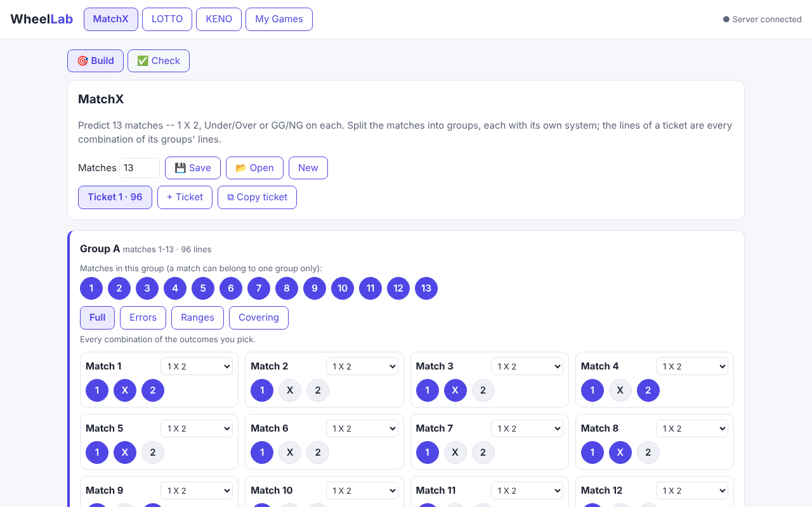
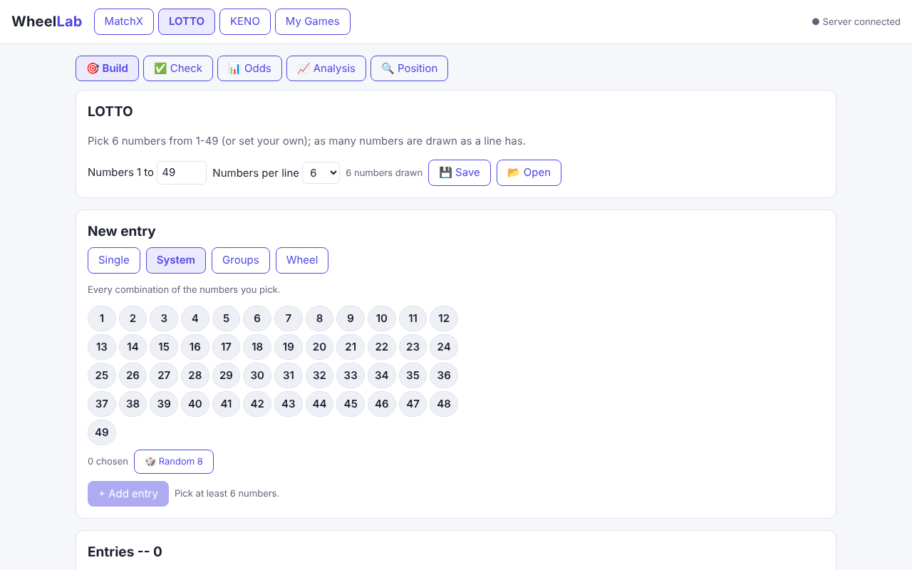
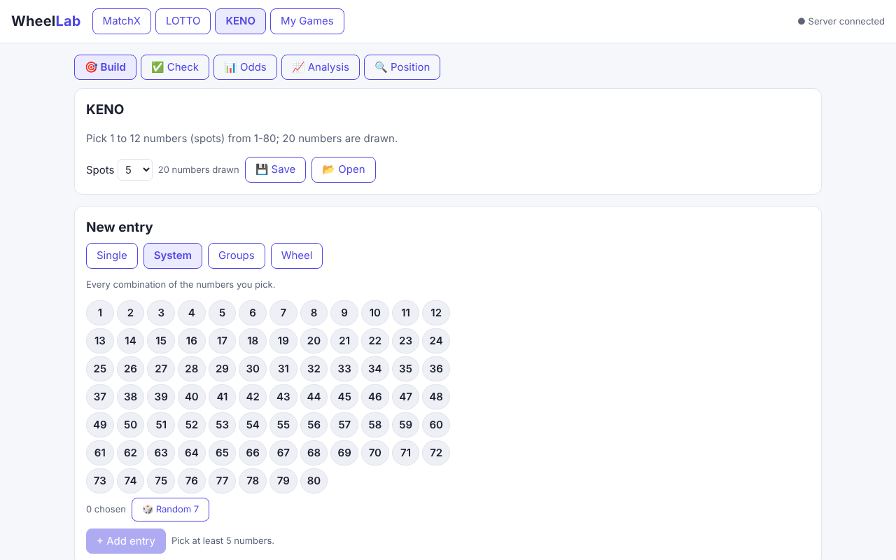

**WheelLab** builds and checks **full, reduced and custom systems** for match-result predictions and
number games, with exact counts and hit statistics for systems of any size, without generating a single
line until you ask to see them. It is free and open source: a Java server and a web app that run on your
own computer.

[Source code on GitHub](https://github.com/ckokolog-ship-it/WheelLab) ·
[Install on Windows 11](install-windows.md) ·
[How it works](how-it-works.md)

## The games

| Game | What you do |
|---|---|
| **MatchX** | predict up to 20 matches (1 X 2, Under/Over, GG/NG) with Full, Errors, Ranges and Covering systems |
| **LOTTO** | 6 from 1-49 (adjustable): single lines, systems, groups and wheels |
| **KENO** | 1-12 spots from 1-80, 20 drawn |
| **My Games** | number games you define: any range, pick and draw, an optional bonus pool, and a text language |

In every game: **check** a result instantly (hit tables for systems of any size, with your own prizes),
list the lines with a given number of hits, see the exact **odds**, **analyse** systems (odd/even, last
digit, frequencies) and find the **position** of any line.

### MatchX: groups of matches, each with its own system



### LOTTO: single lines, systems, groups and wheels



### KENO: 1 to 12 spots from 1-80



## Guides

| Guide | |
|---|---|
| [MatchX](matchx.md) | tickets, groups, the four systems, check |
| [LOTTO and KENO](lotto-keno.md) | entries, wheels, prizes, odds, position |
| [My Games](my-games.md) | your own games, bonus pools, the game language, analyses |
| [How it works](how-it-works.md) | lazy lines, formulas instead of scanning, proved reduced systems |
| [API reference](api.md) | every endpoint, with request examples |
| [Install on Windows 11](install-windows.md) | Java, Node.js and Git with winget, then build and run |

## Quick start

Requirements: **Java 17+** and **Node.js 20+** (Maven is not needed: the Maven Wrapper downloads it).

```bash
git clone https://github.com/ckokolog-ship-it/WheelLab.git
cd WheelLab/web && npm install && npm run build
cd ../server && ./mvnw package                               # Windows: .\mvnw.cmd package
java -jar target/wheellab-server.jar --web ../web/dist       # open http://localhost:8090
```

## Verified

Every count, line and hit table is checked against an independent brute force: JUnit tests, and
end-to-end scripts that compare a running server with an enumeration written separately in Python.
